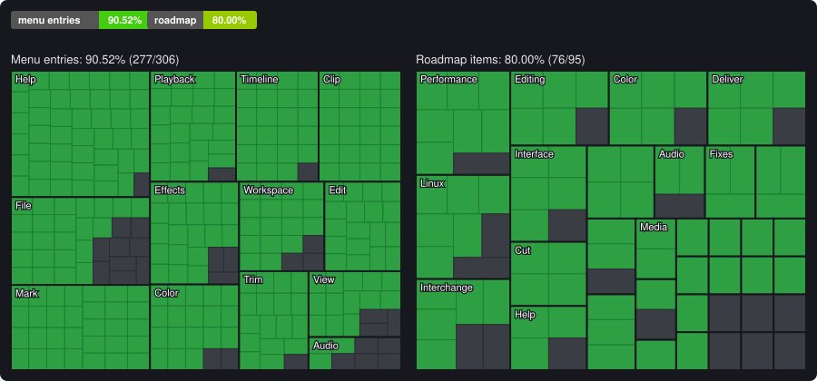

# Picasso Suite

A cross-platform video editor written in Rust, laid out like DaVinci Resolve: Media, Photo, Cut,
Edit, Fusion, Color, Fairlight and Deliver pages. Windows, Linux and macOS.

- **Edit:** media pool and bins, multi-track timeline, linked picture and sound, blade, trim,
  ripple, roll, slip and slide, Dynamic Trim, compound clips, multicam, speed changes and ramps,
  keyframes, transitions, titles, Paste Mix to Current Track, undo/redo.
- **Color:** serial, parallel and layer nodes; lift, gamma, gain and offset wheels; custom curves
  (Y, R, G, B, intensity and soft clip); qualifier and power windows; LUTs; gallery stills;
  parade, waveform, vectorscope and histogram scopes.
- **Fairlight:** per-track EQ and compressor, meters, loudness (BS.1770), recording from the
  microphone, voice-over, Bounce Mix to Track and Bounce Selected Tracks, audio scrubbing.
- **Any format FFmpeg reads:** H.264, H.265/HEVC, ProRes, DNxHR, AV1, VP9 and more, images and
  sound, decoded on the graphics card where it can. FFmpeg comes with every package.
- **Deliver:** H.264, H.265 and AV1 (8 or 10-bit, on the processor or an NVIDIA, Intel, AMD,
  Apple or VA-API encoder), VP9, ProRes, DNxHR, lossless FFV1, WAV, MP3 and PNG sequences, a
  render queue and Resolve's render presets.
- **DaVinci Resolve files:** opens `.drp` projects, `.drt` timelines, `.drb` bins and XML exports
  (name, frame rate, picture size and media).
- **Other editors:** exports timelines as Final Cut Pro 7 / Premiere XML, AAF (Avid Media
  Composer, Pro Tools), OpenTimelineIO and EDL; imports the same XML, AAF, OpenTimelineIO and
  EDL timelines, matching their clips to the media.
- **Keyboard Customization:** any command's keys can be changed.
- **Updates:** Help > Check for Updates installs the latest release.
- **Bug reports:** Help > Export Log File saves the session's log (kept in memory, nothing
  written while you work); `picasso-suite --graphics-check` reports what the graphics card draws
  and whether it decodes video.

## Status

<!-- status:start -->


| | Done | Total | |
|---|---|---|---|
| Menu entries | 277 | 306 | 90.52% |
| Roadmap items* | 76 | 95 | 80.00% |

Green is made, grey is not. Menu entries: every entry of every menu ([`Menu-Status.md`](Menu-Status.md)); the rest are shown disabled. \* Roadmap items ([`ROADMAP.md`](ROADMAP.md)): the to-do items are bigger than the done ones, so this share looks better than the work left. Made by `python3 scripts/status.py`.
<!-- status:end -->

## Screenshots

**Project Manager** - your local projects, with New Project, Open, Import and Export.


**Media** - browse your drives, preview a clip with its embedded audio meters, and read its metadata (codec, resolution, frame rate, size, path) before adding it to the media pool.


**Photo** - the photo album, viewer, rating bar and inspector, laid out as in Resolve.


**Cut** - the media pool and viewer over two timelines: the whole edit on top, a close-up around the playhead below. Drag a clip from the pool onto either one.


**Edit** - source and timeline viewers, the toolbar, and video and audio tracks with thumbnails and waveforms.


**Fusion** - the clip's MediaIn and MediaOut nodes, the viewer, the frame ruler and the inspector.


**Color** - clip thumbnails, the node graph, color wheels, Curves with a live histogram, and RGB parade scopes.


**Fairlight** - audio tracks with waveforms, track and bus meters, loudness, and the mixer.


**Deliver** - Custom Export render settings, the render queue, clip thumbnails and the timeline.


## Install

Download a package from the [latest release](https://github.com/fabox-os/Picasso-Suite/releases/latest).
FFmpeg is included in all of them.

| OS | Package | Install |
|---|---|---|
| Windows | `picasso-suite-0.6.3-windows.zip` | Unzip the whole folder and run `picasso-suite.exe` |
| macOS (Apple silicon and Intel) | `picasso-suite-0.6.3-macos-universal.zip` | Unzip, move to Applications, right-click → Open (the app is not signed); Intel Macs need macOS 15 or newer |
| macOS (Apple silicon only) | `picasso-suite-0.6.3-macos-arm64.zip` | Unzip, move to Applications, right-click → Open (the app is not signed) |
| Debian/Ubuntu (22.04 or newer) | `picasso-suite-0.6.3-amd64.deb` | `sudo apt install ./picasso-suite-0.6.3-amd64.deb` |
| Fedora/openSUSE | `picasso-suite-0.6.3-x86_64.rpm` | `sudo dnf install ./picasso-suite-0.6.3-x86_64.rpm` (openSUSE: `sudo zypper install`) |
| Any Linux | `picasso-suite-0.6.3.flatpak` | `flatpak install ./picasso-suite-0.6.3.flatpak` |
| Any Linux (glibc 2.35 or newer), no install | `picasso-suite-0.6.3-x86_64.AppImage` | `chmod +x picasso-suite-0.6.3-x86_64.AppImage`, then run it |
| Linux on ARM64 | `picasso-suite-0.6.3-arm64.deb`, `-aarch64.rpm`, `-aarch64.AppImage`, `-aarch64.flatpak` | as above |

The ARM64 packages, the AppImage and the ARM64 Flatpak come with releases after 0.2.1; the universal macOS app with 0.3.0 and later.

On Linux the packages add Picasso Suite to the applications menu, open `.picasso`, `.drp`, `.drt`
and `.drb` files with it, and offer it under "Open With" for video files. On a Wayland desktop the
window opens through XWayland, because files dropped on a Wayland window do not reach the program
yet (a limit of winit, the window library); `PICASSO_WAYLAND=1 picasso-suite` opens a native
Wayland window without drag and drop. The Flatpak can read your home folder and drives mounted
under `/media` and `/run/media`.

If the window stays black, is slow or shows picture errors, run `picasso-suite --graphics-check`: it
lists the graphics cards and interfaces (Vulkan, DirectX 12, Metal, OpenGL) the computer offers and
whether each one draws a test picture, and saves the answer as `picasso-graphics-report.txt` in the
current folder (the Windows program has no console window to print to). Please
[send it in](https://github.com/fabox-os/Picasso-Suite/issues/new?template=graphics-report.yml),
working or not: only a few graphics cards have been tried.

## Build from source

Requires **Rust** 1.95 or newer, FFmpeg 7.1 (the shared build, with its headers and libraries) and
LLVM 19 for the FFmpeg bindings (newer LLVM produces empty structs). Point these variables at them:

```
FFMPEG_DIR=<folder with include/ lib/ bin/>
LIBCLANG_PATH=<LLVM bin folder>
```

On Windows, [BtbN's FFmpeg 7.1 shared build](https://github.com/BtbN/FFmpeg-Builds) works; run from a
Visual Studio developer prompt so the bindings find the MSVC headers. On macOS,
`brew install ffmpeg@7` and set `PKG_CONFIG_PATH` to its `lib/pkgconfig` instead of `FFMPEG_DIR`. On
Linux, also install the window and sound headers:

| OS | Packages |
|---|---|
| Debian/Ubuntu | `sudo apt install build-essential pkg-config clang libclang-dev libxkbcommon-dev libgl1-mesa-dev libwayland-dev libx11-dev libxcursor-dev libxrandr-dev libxi-dev libasound2-dev` |
| Fedora | `sudo dnf install gcc pkgconf clang-devel libxkbcommon-devel mesa-libGL-devel wayland-devel libX11-devel alsa-lib-devel` |

```bash
cargo run --release -p picasso-suite
```

`picasso-suite [--place] <project or media file>...` opens a project, or imports media (with
`--place`, also onto the timeline). `cargo test --workspace` runs the tests.

## DaVinci Resolve files

File > Open (or dropping the file on the window) opens a DaVinci Resolve project (`.drp`),
timeline (`.drt`), bin (`.drb`) or XML export. The new project takes its name, frame rate and
picture size, and its media pool gets every media file the Resolve file uses; files that are not on
this computer are kept as offline media. Where clips sit on Resolve's timelines is not read yet.

The same works from a terminal with `picasso-bridge`, which also registers the files on Linux:

```sh
picasso-bridge info project.drp              # name, rate, size and media (missing files marked ?)
picasso-bridge convert project.drp           # writes project.picasso next to it
picasso-bridge install-linux                 # .drp/.drt/.drb/.picasso open with Picasso Suite
```

## Layout

| Folder | Role |
|---|---|
| `crates/picasso-core` | the project model, every edit as a command, undo history, project files |
| `crates/picasso-color` | grading maths (wheels, curves, qualifier, windows, LUTs) and the scopes |
| `crates/picasso-decode` | FFmpeg: probe, video frames, audio, waveforms |
| `crates/picasso-audio` | the mix, background audio decoding and the sound card output |
| `crates/picasso-media` | facts about imported media and the `.picasso` project file (SQLite) |
| `crates/picasso-export` | rendering to files through FFmpeg |
| `crates/picasso-render` | the compositor that makes a frame |
| `crates/picasso-drp` | reads DaVinci Resolve files |
| `crates/picasso-ui` | the interface: pages, timeline, wheels, scopes, menus, icons |
| `apps/studio` | the desktop program (and the WebAssembly entry point) |
| `apps/bridge` | `picasso-bridge`, Resolve files from the command line |

The menus follow [`Menu-Spec.md`](Menu-Spec.md); [`Menu-Status.md`](Menu-Status.md) lists which entries
work. The code never panics (no `unwrap`, `expect` or `panic!`) and every change to a project is a
command.

## Licence

GPL-3.0-or-later. The bundled Noto Sans fonts (`crates/picasso-ui/assets/fonts`) are under the SIL
Open Font License 1.1 (`OFL.txt` beside them). FFmpeg, included in the packages, is under the GPL
(`FFMPEG-LICENSE`). Not affiliated with Blackmagic Design.
